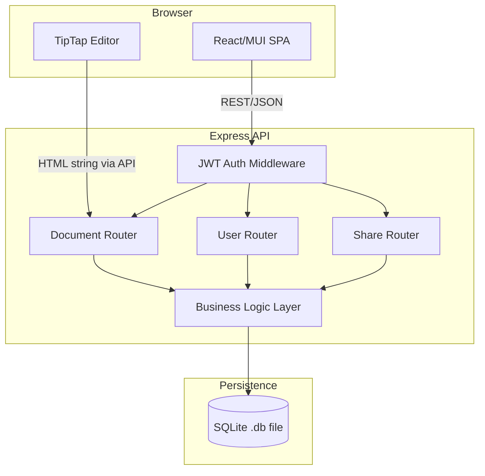

# Design Document: Collaborative Document Editor

## Overview

A lightweight collaborative document editor built as a single-page React app backed by a Node.js/Express REST API. Documents are stored in a SQLite database via Node's built-in `node:sqlite` module (Node 22+). The TipTap editor handles rich-text rendering and serializes content as HTML strings. Sharing is modelled as a simple join table between users and documents. There is no real-time sync (no WebSockets) — the collaboration model is optimistic last-write-wins with periodic auto-save, appropriate for the 4–6 hour build timebox.

The system has two deployable units:

- **Frontend** — Vite + React + MUI, served as static assets (or via `vite dev` locally)
- **Backend** — Express REST API that owns all business logic, validation, and SQLite access

Authentication is mocked: users are seeded at startup, login issues a JWT stored in `localStorage`, and the token is verified by Express middleware on protected routes. No password hashing beyond a simple comparison is required to meet the lightweight auth requirement.

---

## Architecture



**Key design decisions:**

- **SQLite / `node:sqlite`**: Uses Node.js's built-in `node:sqlite` module (`DatabaseSync`), available in Node 22+. Synchronous API, zero-config, file-based, and — crucially — **no native compilation or prebuilt binaries required**, avoiding toolchain/DLL issues on Windows. Run with the `--experimental-sqlite` flag. All queries run synchronously on the Node.js thread; Express routes remain async only where needed for file I/O. Note: `node:sqlite` has no `db.transaction()` helper (unlike `better-sqlite3`), so transactions use explicit `exec('BEGIN'/'COMMIT'/'ROLLBACK')`.
- **JWT auth (mocked)**: Stateless, easy to verify in middleware. Users are seeded; no registration flow needed.
- **HTML as content format**: TipTap can serialize to/from HTML natively. Storing raw HTML in SQLite is simpler than JSON prosemirror schema for this scope.
- **No WebSockets**: Real-time sync adds significant complexity. Last-write-wins auto-save satisfies the collaboration requirement within the timebox.

---

## Components and Interfaces

### Frontend Components

| Component          | Responsibility                                                              |
| ------------------ | --------------------------------------------------------------------------- |
| `LoginPage`        | Username + optional password form; calls `POST /api/auth/login`; stores JWT |
| `DocumentListPage` | Fetches and renders owned + shared docs; navigates to editor                |
| `EditorPage`       | Hosts TipTap editor; handles save, auto-save timer, share dialog            |
| `ShareDialog`      | MUI Dialog; calls `POST /api/documents/:id/shares`                          |
| `FileUploadButton` | File picker with type/size validation; calls `POST /api/documents/import`   |
| `AuthGuard`        | HOC/wrapper that redirects unauthenticated users to `/login`                |

### Backend Routers

#### `POST /api/auth/login`

- Body: `{ username, password? }`
- Returns: `{ token, user: { id, username } }`

#### `GET /api/documents`

- Auth required
- Returns: array of documents where `owner_id = userId` OR a share grant exists

#### `POST /api/documents`

- Auth required
- Body: `{ title? }` (defaults to "Untitled Document")
- Creates document, assigns owner, returns document record

#### `GET /api/documents/:id`

- Auth required; access check (owner or collaborator)
- Returns: full document record including content

#### `PUT /api/documents/:id`

- Auth required; access check
- Body: `{ title?, content? }`
- Updates title and/or content, bumps `updated_at`

#### `POST /api/documents/import`

- Auth required
- Multipart form with file; validates type (`.txt`, `.md`) and size (≤ 10 MB)
- Creates document with file text as initial content

#### `POST /api/documents/:id/shares`

- Auth required; owner-only
- Body: `{ username }`
- Looks up user, inserts share grant, returns updated collaborator list

#### `GET /api/documents/:id/shares`

- Auth required; owner-only
- Returns list of collaborators

#### `GET /api/users`

- Auth required
- Returns all users (for username lookup in share dialog)

### Middleware

- `authenticateToken(req, res, next)` — validates `Authorization: Bearer <jwt>`, attaches `req.user`
- `requireDocumentAccess(req, res, next)` — checks owner or collaborator, attaches `req.document`
- `requireDocumentOwner(req, res, next)` — stricter check: owner only

---

## Data Models

### SQLite Schema

```sql
CREATE TABLE users (
  id       INTEGER PRIMARY KEY AUTOINCREMENT,
  username TEXT NOT NULL UNIQUE,
  password TEXT NOT NULL          -- plain text for mock auth; bcrypt if time allows
);

CREATE TABLE documents (
  id         INTEGER PRIMARY KEY AUTOINCREMENT,
  title      TEXT    NOT NULL DEFAULT 'Untitled Document',
  content    TEXT    NOT NULL DEFAULT '',   -- HTML string from TipTap
  owner_id   INTEGER NOT NULL REFERENCES users(id),
  created_at TEXT    NOT NULL DEFAULT (datetime('now')),
  updated_at TEXT    NOT NULL DEFAULT (datetime('now'))
);

CREATE TABLE document_shares (
  document_id INTEGER NOT NULL REFERENCES documents(id) ON DELETE CASCADE,
  user_id     INTEGER NOT NULL REFERENCES users(id)     ON DELETE CASCADE,
  PRIMARY KEY (document_id, user_id)
);
```

**Seeds** (inserted at startup if not present):

- `users`: `alice / password1`, `bob / password2`

### JavaScript Data Transfer Objects

```typescript
// Document list item (returned by GET /api/documents)
type DocumentSummary = {
  id: number;
  title: string;
  ownerUsername: string;
  isOwner: boolean; // true if current user is owner
  updatedAt: string; // ISO 8601
};

// Full document (returned by GET /api/documents/:id)
type DocumentDetail = {
  id: number;
  title: string;
  content: string; // raw HTML
  ownerUsername: string;
  isOwner: boolean;
  updatedAt: string;
};

// Share entry (returned by GET /api/documents/:id/shares)
type ShareEntry = {
  userId: number;
  username: string;
};
```

---

## Correctness Properties

_A property is a characteristic or behavior that should hold true across all valid executions of a system — essentially, a formal statement about what the system should do. Properties serve as the bridge between human-readable specifications and machine-verifiable correctness guarantees._

This feature is suitable for property-based testing on the backend. The core logic — authentication, document CRUD, access control, and sharing — is pure function-like: given a request with known inputs, the system should produce a deterministic, verifiable output. TipTap/frontend formatting requirements are excluded as they are not backend concerns.

### Property 1: Authentication succeeds for all valid users

_For any_ username that exists in the user table, a `POST /api/auth/login` request with that username and correct password SHALL return an HTTP 200 response containing a valid JWT token.

**Validates: Requirements 1.2**

---

### Property 2: Protected routes reject unauthenticated requests

_For any_ protected API endpoint, a request that omits the `Authorization` header or provides an invalid token SHALL receive an HTTP 401 response.

**Validates: Requirements 1.4**

---

### Property 3: Document creation invariants

_For any_ authenticated user, creating a document via `POST /api/documents` SHALL produce a document record where (a) the title equals the default `"Untitled Document"`, (b) the content is empty, (c) the `owner_id` equals the creating user's id, and (d) the document is subsequently retrievable by that user via `GET /api/documents/:id`.

**Validates: Requirements 2.1, 2.3, 2.4**

---

### Property 4: Document update round-trip

_For any_ document the current user has access to, and _for any_ valid title string and any HTML content string, saving those values via `PUT /api/documents/:id` and then retrieving the document via `GET /api/documents/:id` SHALL return the exact same title and content that were saved.

**Validates: Requirements 2.2, 5.1, 5.3**

---

### Property 5: Document list completeness and shape

_For any_ user with a combination of owned documents and documents shared with them, `GET /api/documents` SHALL return exactly those documents (no more, no less), and each entry SHALL contain the fields `title`, `ownerUsername`, `updatedAt`, and `isOwner` with correct values.

**Validates: Requirements 3.1, 3.4**

---

### Property 6: File import round-trip

_For any_ text string uploaded as a `.txt` or `.md` file (within the 10 MB limit), `POST /api/documents/import` SHALL create a new document whose content contains that text, and SHALL return 400 for unsupported file types or files exceeding 10 MB.

**Validates: Requirements 6.1, 6.2, 6.5**

---

### Property 7: Sharing round-trip and collaborator access

_For any_ document owned by user A and any other existing user B, granting a share via `POST /api/documents/:id/shares` with B's username SHALL (a) add B to the collaborator list returned by `GET /api/documents/:id/shares`, (b) cause the document to appear in B's `GET /api/documents` list, and (c) allow B to successfully `GET /api/documents/:id` and `PUT /api/documents/:id`.

**Validates: Requirements 7.2, 7.4**

---

### Property 8: Non-owner share control is forbidden

_For any_ document and _for any_ user who is not the owner of that document, both `POST /api/documents/:id/shares` and `GET /api/documents/:id/shares` SHALL return HTTP 403.

**Validates: Requirements 7.5, 7.6**

---

### Property 9: Error responses are always human-readable JSON

_For any_ request that results in a 4xx or 5xx response, the response body SHALL be valid JSON containing a `message` field with a non-empty string, and SHALL NOT include a raw stack trace.

**Validates: Requirements 9.2, 9.3**

---

## Error Handling

### Strategy

All errors are caught at the route/middleware level and formatted as `{ message: string }` JSON responses. No raw `Error.stack` is ever sent to clients in production mode.

| Scenario                                 | HTTP Status | Response Body                                                      |
| ---------------------------------------- | ----------- | ------------------------------------------------------------------ |
| Missing or invalid JWT                   | 401         | `{ message: "Unauthorized" }`                                      |
| Authenticated but not owner/collaborator | 403         | `{ message: "Forbidden" }`                                         |
| Document not found                       | 404         | `{ message: "Document not found" }`                                |
| User not found (during share)            | 404         | `{ message: "User not found" }`                                    |
| Required field missing                   | 400         | `{ message: "Field '<name>' is required" }`                        |
| Unsupported file type                    | 400         | `{ message: "Unsupported file type. Supported types: .txt, .md" }` |
| File too large                           | 400         | `{ message: "File exceeds the 10 MB size limit" }`                 |
| SQLite / unexpected error                | 500         | `{ message: "Internal server error" }`                             |

### Global Error Middleware

Express error-handling middleware (`(err, req, res, next)`) at the bottom of the app catches all unhandled throws and formats them using the table above. In development mode it may log the stack to the console but never to the HTTP response.

### Frontend Error Handling

Frontend wraps all `fetch` calls in try/catch, reads `response.message` from non-2xx responses, and displays it in a MUI `Alert` component. If the alert is blocking a save, the editor content is retained in React state.

---

## Testing Strategy

### Scope

Per requirements, **only backend unit tests are in scope**. Frontend testing is explicitly excluded (Requirement 10.4).

### Framework

**Jest** with **mock-based unit testing** — no `supertest`, no native SQLite binary required. Route handlers are tested directly by passing mock `req`/`res` objects. The database layer is replaced with a lightweight in-memory JS mock that implements the same `prepare().get()` / `prepare().run()` / `prepare().all()` interface as `better-sqlite3`.

This approach eliminates the need to compile native binaries (no `better-sqlite3` in tests) and keeps tests fast and portable across all platforms.

### Structure

```
server/
  __tests__/
    helpers/
      mockDb.js             # In-memory mock db factory (plain JS objects, no SQLite)
      mockReqRes.js         # Helper to create mock req/res objects
    auth.test.js            # Properties 1, 2
    documents.test.js       # Properties 3, 4, 5
    import.test.js          # Property 6
    sharing.test.js         # Properties 7, 8
    errors.test.js          # Property 9
```

### Mock Database

`mockDb.js` exports a `createMockDb()` factory that returns a plain JS object mimicking the `better-sqlite3` interface:

```js
// Returns a mock db with in-memory users/documents/shares arrays
export function createMockDb(seed = true) {
  const users = seed
    ? [
        { id: 1, username: "alice", password: "password1" },
        { id: 2, username: "bob", password: "password2" },
      ]
    : [];
  const documents = [];
  const shares = [];
  // prepare(sql) returns { get, run, all } backed by the in-memory arrays
  return { prepare, users, documents, shares };
}
```

### Mock Request / Response

`mockReqRes.js` exports `mockReq(overrides)` and `mockRes()` helpers:

```js
// mockRes captures status(), json(), and end() calls for assertions
export function mockRes() {
  const res = { statusCode: 200 };
  res.status = (code) => {
    res.statusCode = code;
    return res;
  };
  res.json = (body) => {
    res.body = body;
    return res;
  };
  return res;
}
```

Route handlers are invoked directly:

```js
const req = mockReq({ body: { username: "alice", password: "password1" } });
const res = mockRes();
await loginHandler(req, res);
expect(res.statusCode).toBe(200);
expect(res.body.token).toBeDefined();
```

### Property-Based Testing

The project uses **[fast-check](https://fast-check.dev/)** for property-based testing in Jest.

Each property test is tagged with a comment referencing the design property:

```js
// Feature: collaborative-doc-editor, Property 4: document update round-trip
```

Minimum **100 iterations** per property test (`numRuns: 100` in fast-check config).

### Property Test Arbitraries (Generators)

| Property                         | Generators Used                                                                                |
| -------------------------------- | ---------------------------------------------------------------------------------------------- |
| P1: Auth succeeds                | `fc.constantFrom(...seededUsers)`                                                              |
| P2: Protected routes reject      | `fc.constantFrom(...protectedRoutes)`, `fc.string()` for bad tokens                            |
| P3: Document creation invariants | `fc.constantFrom(...seededUsers)`                                                              |
| P4: Document update round-trip   | `fc.string()` for title, `fc.string()` for HTML content                                        |
| P5: Document list completeness   | `fc.integer({ min: 0, max: 5 })` for owned/shared doc counts                                   |
| P6: File import round-trip       | `fc.string()` for text content, `fc.constantFrom('.txt', '.md', '.pdf', '.exe')` for extension |
| P7: Sharing round-trip           | Pair of distinct seeded users, `fc.integer` for doc id                                         |
| P8: Non-owner forbidden          | Any user other than owner                                                                      |
| P9: Error response shape         | `fc.constantFrom(...errorTriggeringRequests)`                                                  |

### Unit / Example Tests

In addition to property tests, each test file includes example-based tests covering:

- Login with wrong password returns 401
- Missing token returns 401
- Share with non-existent username returns 404 (Requirement 7.3)
- Missing required field returns 400 with correct message (Requirement 9.1)

### Running Tests

```bash
# From server/ directory
npm test          # jest --runInBand
```

No native binaries, no network, no file I/O — all tests run against in-memory JS mocks.
